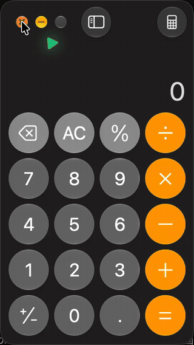

# nuphy-air60-v2-tools

One NuPhy Air60 V2, two computers, one monitor, and no mouse.



## Intent

- **Point without a mouse.** Tap Caps, then press letter keys roughly where you want to go. The key's position on the keyboard is the direction and distance, and the cursor snaps to the button that lies there. Hold a key to keep stepping. The keys you press light up.
- **One switch changes the whole desk.** The rear Mac/Win switch moves the keyboard to the other computer, and the monitor follows it.
- **Type Dvorak everywhere.** The layout lives in the keyboard, so every computer and the Japanese IME get the same Dvorak. Tap Ctrl to toggle Japanese.
- **Recover without the Windows-only NuPhy Console.** Re-flash the Bluetooth chip and the keyboard firmware from a Mac when pairing breaks.
- **Never lose the setup by accident.** Touching Esc while plugging in no longer wipes the keymap.

## Get started

```sh
make                       # Swift tools, needs Xcode Command Line Tools
firmware/build.sh          # custom keyboard firmware, needs arm-none-eabi-gcc
scripts/caps-mouse.sh      # keyboard wired: Caps pad and mouse layer
scripts/dvorak-ime.sh      # keyboard wired: Dvorak and the Ctrl IME toggle
```

Run `bin/snap` and `bin/kvm-switch` as login agents. `snap` needs Accessibility permission.

The firmware is unofficial. To go back, flash NuPhy's release from <https://nuphy.com/pages/qmk-firmwares>.

## License

MIT. See [LICENSE](LICENSE).
